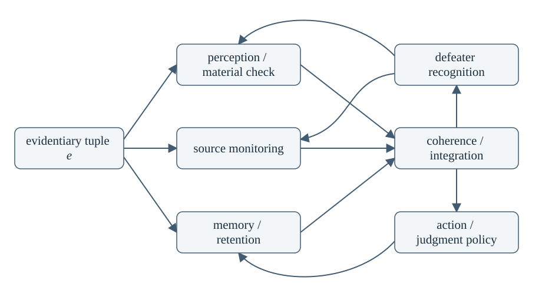

# Epistemic Tuples and Intra-Agential Equilibrium: reading companion

This companion restores notation and the architecture diagram from the September 2026 paper. Read it alongside the [complete immutable extraction][original], which retains all prose, definitions, six propositions, qualifications and references. This is a **source transcription**, not a revised paper or a new mathematical result. The [published ET05 correction][correction] remains a separate scientific assessment.

The transcription authority is the original 18-page PDF, SHA-256 `d39f084222fe3b372b365a729b1cd3e4ab6c09c389efaeb18d7727d4b845aba5`. The extraction's SHA-256 is `a81201d5cb53b8c6d3d5eaf47abc704286f879cf78579421d6db6e0800fc5255`. The PDF is not redistributed. Both identities are classified `reviewed_owner_authored` in the existing [public projection manifest][projection]; the owner's bounded authorization permits this separately reviewed transcription. The binary's existing publication hold remains in force. [FIDELITY.json](FIDELITY.json) records the source bindings, transformations and inherited 25-document coverage dispositions.

Physical PDF page 1 is the unnumbered cover; printed pages 1–17 are physical pages 2–18. F01–F30 identify comparison groups, not original equation numbers. Display breaks and spacing are editorial. Calligraphic $\mathcal E$ in F01 and F24 follows the PDF, correcting plain `E` in the supplied comparison checklist. The remaining notation follows the source, including its historical ambiguities.

## Read with the complete paper

| Original section | Complete prose | Restored material here |
|---|---|---|
| 1. Executive statement; 2. Evidentiary weight as a tuple | [Sections 1–2][s1] | [F01–F06](#f01-evidentiary-profile) |
| 3. What makes an evidentiary tuple epistemic | [Section 3][s3] | [F07](#f07-differentiated-cognitive-loci), [diagram](#architecture-diagram) |
| 4. From cognitive architecture to game structure; 5. Mixed epistemic policies | [Sections 4–5][s4] | [F08–F11](#f08-finite-response-set) |
| 6. Exactly where Nash enters | [Section 6][s6] | [F12–F14](#f12-real-valued-payoffs) |
| 7. The vector-valued problem | [Section 7][s7] | [F15–F16 and correction boundary](#f15-cone-ordered-improvement) |
| 8. Nash may exist and still be the wrong solution concept | [Section 8][s8] | [F17–F19](#f17-team-objective) |
| 9. Worked example: hadith and inscriptions | [Section 9][s9] | [F20–F22](#f20-example-coordinates) |
| 10. A formal hierarchy of claims | [Section 10][s10] | [L0–L7 table](#formal-hierarchy) |
| 11. Propositions and consequences | [All six propositions][s11] | Retained in full in the extraction |
| 12. Common misunderstandings | [Section 12][s12] | Retained in full in the extraction |
| 13. The deeper epistemological picture | [Section 13][s13] | [F23](#f23-regulation-as-coordination) |
| 14. Research programme | [All eight steps][s14] | Retained in full in the extraction |
| 15. Compact formal template | [Section 15][s15] | [F24–F30](#f24-evidence-space-and-faculties) |
| 16. Conclusion; A. Glossary; B. Minimal references | [Conclusion][s16], [glossary][glossary], [references][references] | Retained in full in the extraction |

The six proposition titles are “tuple preservation,” “endogenous cognition,” “finite-game mixed architecture,” “conditional Nash existence,” “equilibrium is not truth,” and “vector order changes the solution concept.” Their full statements and qualifications remain at the linked source. Line anchors count LF boundaries in the immutable extraction, including its page form feeds.

## Notation in source order

### F01. Evidentiary profile

Physical p. 4 / printed p. 3; source §1, extraction line 108.

$$
e=(e_1,e_2,\ldots,e_k)\in\mathcal E\subseteq\mathbb R^k
$$

### F02. Scalar evidentiary weight

Physical p. 4 / printed p. 3; source §2.1, line 139.

$$
w(e)\in\mathbb R
$$

### F03. Example tuple

Physical p. 4 / printed p. 3; source §2.1, line 143.

$$
e=(p,t,i,s,d,c,\ldots)
$$

The source lists provenance quality, temporal proximity, independence, semantic specificity, defeater exposure, coherence, or other case-specific dimensions. It does not declare a universal coordinate system.

### F04. Incomparability

Physical p. 5 / printed p. 4; source §2.1, lines 151–155. Two profiles may satisfy **neither**

$$
e\ge f\quad\text{nor}\quad f\ge e
$$

under coordinatewise comparison. The source's example is

$$
e=(0.90,0.35,0.80),\qquad f=(0.55,0.92,0.70).
$$

### F05. Partial order

Physical p. 5 / printed p. 4; source §2.2, lines 161–166.

$$
K\subseteq\mathbb R^k
$$

$$
x\succeq_K y\iff x-y\in K
$$

$$
K=\mathbb R_{\ge0}^k
$$

The last display is the source's simplest coordinatewise case.

### F06. Weighted scalarisation

Physical p. 5 / printed p. 4; source §2.2, lines 175–182.

$$
U(e)=\sum_{j=1}^k\alpha_j e_j
$$

The source requires justification for coordinates, trade-offs and weights; this formula does not license scalarisation by itself.

### F07. Differentiated cognitive loci

Physical p. 6 / printed p. 5; source §3.1, lines 199–228.

$$
\mathcal F=\{F_1,F_2,\ldots,F_n\}
$$

Mutual conditioning motivates writing

$$
F_i(e,s_{-i})
$$

rather than merely

$$
F_i(e).
$$

## Architecture diagram

Physical p. 6 / printed p. 5; source §3.2, lines 230–247. The diagram is redrawn with the original seven labels and eleven directed edges; spacing and curves are presentation changes.

The source's qualification is retained: “The arrows are not a claim about a uniquely correct psychology. They display the structural idea: epistemic responses can be recursively and mutually conditioning.”

Accessible directed edge list (the last three are feedback arrows):

1. evidentiary tuple e → perception / material check
2. evidentiary tuple e → source monitoring
3. evidentiary tuple e → memory / retention
4. perception / material check → coherence / integration
5. source monitoring → coherence / integration
6. memory / retention → coherence / integration
7. coherence / integration → defeater recognition
8. coherence / integration → action / judgment policy
9. defeater recognition → perception / material check
10. defeater recognition → source monitoring
11. action / judgment policy → memory / retention

## From response sets to equilibrium

### F08. Finite response set

Physical p. 7 / printed p. 6; source §4.1, lines 254–258.

$$
S_i=\{s_i^1,\ldots,s_i^{m_i}\}
$$

### F09. Functional encoding and joint response

Physical p. 7 / printed p. 6; source §4.1, lines 266–269.

$$
F_i\leftrightarrow\text{player }i,\qquad S_i\leftrightarrow\text{strategy set of }i
$$

$$
s=(s_1,\ldots,s_n)\in S_1\times\cdots\times S_n
$$

### F10. Mixed response simplex

Physical p. 7 / printed p. 6; source §5, lines 289–298.

$$
\Delta(S_i)=\left\{p_i\in\mathbb R_{\ge0}^{m_i}:\sum_{j=1}^{m_i}p_{ij}=1\right\}
$$

### F11. Joint mixed-policy space

Physical p. 7 / printed p. 6; source §5, lines 300–307.

$$
\Sigma=\prod_{i=1}^{n}\Delta(S_i)
$$

Finiteness and a meaningful cognitive interpretation of mixture are assumptions. The source's §5.1 lists stochastic uptake, graded policy, unresolved competition, and population or temporal interpretation. The model must specify the intended interpretation; a probability vector is not automatically a literal mental roulette wheel. Convexity alone is not the Nash theorem.

### F12. Real-valued payoffs

Physical p. 8 / printed p. 7; source §6.1, line 335.

$$
u_i:S_1\times\cdots\times S_n\to\mathbb R
$$

### F13. Mixed Nash equilibrium

Physical p. 8 / printed p. 7; source §6.1, lines 340–346. There exists

$$
\sigma^*\in\Sigma
$$

satisfying

$$
u_i(\sigma_i^*,\sigma_{-i}^*)\ge u_i(\sigma_i,\sigma_{-i}^*)
$$

for every player $i$ and every alternative mixed response $\sigma_i\in\Delta(S_i)$, under the source's finite-game and real-valued mixed-extension assumptions. This is conditional Nash existence, not an unconditional epistemic guarantee.

### F14. Limits of equilibrium existence

Physical p. 9 / printed p. 8; source §6.2, lines 369–373.

$$
\text{equilibrium existence}\ne\text{correct scalar weighting}\ne\text{historical truth}
$$

### F15. Cone-ordered improvement

Physical p. 9 / printed p. 8; source §§7–7.1, lines 379–386.

$$
U_i(s)\in\mathbb R^k
$$

$$
K_i\subseteq\mathbb R^k
$$

$$
x-y\in K_i
$$

### F16. Original vector-equilibrium statement

Physical p. 9 / printed p. 8; source §7.1, lines 390–395. **Historical source transcription:** for every admissible unilateral deviation $\sigma_i^{\prime}$,

$$
U_i(\sigma_i^{\prime},\sigma_{-i}^*)-U_i(\sigma^*)\notin K_i\setminus\{0\}.
$$

**Separate mathematical correction:** the original formula excludes nonzero cone gains. Adjacent source §7.2 instead says “strictly better in every dimension recognised by its improvement order.” Those conditions differ. This companion preserves both the original formula and the original prose; it does not substitute an interior cone. Read [ET05 strict-cone repair and vector equilibrium][correction], especially its lines 124–155, for the published distinction between nondominated equilibrium and no-every-coordinate-strict-improvement equilibrium, the counterexample, and the weighted-Nash qualifications.

## Other formulations and the numerical example

### F17. Team objective

Physical p. 10 / printed p. 9; source §8.1, lines 414–420.

$$
\max_{\sigma\in\Sigma}W(\sigma)
$$

### F18. Constrained optimisation

Physical p. 10 / printed p. 9; source §8.2, lines 422–429.

$$
\max_{x\in X}f(x)\quad\text{subject to}\quad g_j(x)\le0
$$

### F19. Revision pipeline

Physical p. 10 / printed p. 9; source §8.3, lines 431–437.

$$
e\to F_1(e)\to F_2(F_1(e))\to\cdots\to B
$$

The source also retains correlated and bargaining formulations in §8.4; the game encoding does not uniquely privilege Nash as the intended solution concept.

### F20. Example coordinates

Physical p. 10 / printed p. 9; source §9, lines 454–458.

$$
e=(T,P,I,S,D,C)
$$

Here $T$ is transmission integrity; $P$, temporal/material proximity; $I$, independence from other witnesses; $S$, semantic specificity or richness; $D$, resistance to known defeaters; and $C$, coherence with independently supported background. The worked example is illustrative, not a verdict about actual historical materials.

### F21. Schematic profiles

Physical p. 11 / printed p. 10; source §9, lines 474–478.

$$
h=(0.88,0.56,0.61,0.94,0.73,0.81)
$$

$$
r=(0.72,0.96,0.90,0.42,0.84,0.77)
$$

The numbers are purely schematic. The source preserves incomparable strengths rather than deriving a historical ranking from them.

### F22. Illustrative scalarisation

Physical p. 11 / printed p. 10; source §9.2, lines 499–505.

$$
W(e)=.15T+.30P+.20I+.10S+.15D+.10C
$$

The coefficients illustrate a demanded trade-off that needs a principled explanation; they are not endorsed weights.

## Formal hierarchy

Physical p. 12 / printed p. 11; source §10, lines 516–533. The table transcribes every L0–L7 cell, removing line-wrap hyphenation. Each level adds structure; the paper warns against silently moving between them.

| Level | Added structure | What follows |
|---|---|---|
| L0 | Heterogeneous evidence represented by tuples | Multiple dimensions remain visible; total ranking is not assumed. |
| L1 | A partial order or admissible improvement relation | Dominance and incomparability become formally expressible. |
| L2 | Faculty-mediated apprehension | The tuples are situated within endogenous cognitive operations. |
| L3 | Mutually conditioning functional loci with admissible response sets | An intra-agential strategic interaction can be encoded. |
| L4 | Finite response sets and meaningful mixtures | A compact convex product of mixed response simplices is available. |
| L5 | Real-valued Nash-representable utilities | The structure is a finite normal-form game; a mixed Nash equilibrium exists. |
| L6 | Vector-valued utilities with cone/partial orders | A vector or Pareto equilibrium notion may be used instead of scalar Nash. |
| L7 | Shared objective or hard constraints | Team optimisation or constrained optimisation may supersede non-cooperative equilibrium. |

## Deeper picture and compact template

### F23. Regulation as coordination

Physical p. 14 / printed p. 13; source §13, lines 630–635.

$$
\begin{gathered}
\text{rational belief regulation}\approx{}\\
\text{stable coordination among differentiated epistemic functions}
\end{gathered}
$$

The source immediately qualifies this by evidence, admissible transformations and governing norms. The line break above is for readability.

### F24. Evidence space and faculties

Physical p. 16 / printed p. 15; source §15, lines 705–709.

$$
e\in\mathcal E\subseteq\mathbb R^k
$$

$$
\mathcal F=\{F_1,\ldots,F_n\}
$$

### F25. Admissible responses

Physical p. 16 / printed p. 15; source §15, lines 711–714.

$$
S_i=\{s_i^1,\ldots,s_i^{m_i}\}
$$

### F26. Mixed policies

Physical p. 16 / printed p. 15; source §15, lines 719–723.

$$
\sigma_i\in\Delta(S_i),\qquad\sigma\in\prod_i\Delta(S_i)
$$

### F27. Evaluated outcome

Physical p. 16 / printed p. 15; source §15, lines 726–728.

$$
O_i=G_i(e,\sigma_i,\sigma_{-i})
$$

### F28. Scalar evaluation and Nash condition

Physical p. 16 / printed p. 15; source §15, lines 730–738. If evaluation is scalar and Nash-representable, define

$$
u_i(O_i)\in\mathbb R
$$

and seek $\sigma^*$ satisfying

$$
u_i(\sigma_i^*,\sigma_{-i}^*)\ge u_i(\sigma_i,\sigma_{-i}^*)
$$

for every admissible unilateral deviation. **Editorial notation note:** the compact source uses $u_i$ both on outcomes and on strategy profiles. That overload is retained, not silently regularised.

### F29. Vector evaluation

Physical p. 16 / printed p. 15; source §15, lines 740–742.

$$
U_i(O_i)\in\mathbb R^q
$$

The source then calls for an improvement cone $K_i$ and a profile with no unilateral strict $K_i$-improvement. Its dimension $q$ is retained even though earlier displays use $k$. This transcription does not resolve the strictness ambiguity; see [F16 and the existing correction](#f16-original-vector-equilibrium-statement).

### F30. Common-objective formulation

Physical p. 16 / printed p. 15; source §15, lines 744–749.

$$
\operatorname*{arg\,max}_{\sigma\in\Sigma}W(e,\sigma)
$$

The source makes this subject to architectural constraints. Its conclusion treats equilibrium, where appropriate, as an account of coordination stability, not a substitute for truth or a licence for unexplained scalarisation.

## Fidelity and scope

This supplement changes presentation only: readable TeX notation, a redrawn directed graph, table layout, page/line navigation and labelled editorial context. It has a new identity and does not claim byte identity with the PDF or extraction. The complete original prose remains in the linked immutable source. [FIDELITY.json](FIDELITY.json) distinguishes inherited binary-coverage findings from this paper's fresh transcription review. The other 24 binaries were not re-reviewed and remain excluded. Their historical-expression coverage is not relabelled exact-text equivalence.

T20's missing R3 successor, unavailable originals, bounded primary readings and uncertified historical research duration remain explicit in the [T20 public projection][t20]. This repair changes no theorem status, T20 acceptance or T21 status. Automated checks bind reviewed bytes and detect omissions; they do not independently establish mathematical truth or publication rights.

[original]: ../../t20-v6-20261012/sources/a81201d5cb53b8c6d3d5eaf47abc704286f879cf78579421d6db6e0800fc5255/Epistemic_Tuples_and_Intra_Agential_Equilibrium.txt
[correction]: ../../t20-v6-20261012/sources/c67c2fa0a538875a2bbbc0df51ad7877a6a701d11cb1567af4f250ff7c2724ad/research.md#5-et05-strict-cone-repair-and-vector-equilibrium
[projection]: ../../t20-v6-20261012/PUBLIC_PROJECTION_MANIFEST.json
[t20]: ../../t20-v6-20261012/README.md
[s1]: ../../t20-v6-20261012/sources/a81201d5cb53b8c6d3d5eaf47abc704286f879cf78579421d6db6e0800fc5255/Epistemic_Tuples_and_Intra_Agential_Equilibrium.txt#L102
[s3]: ../../t20-v6-20261012/sources/a81201d5cb53b8c6d3d5eaf47abc704286f879cf78579421d6db6e0800fc5255/Epistemic_Tuples_and_Intra_Agential_Equilibrium.txt#L185
[s4]: ../../t20-v6-20261012/sources/a81201d5cb53b8c6d3d5eaf47abc704286f879cf78579421d6db6e0800fc5255/Epistemic_Tuples_and_Intra_Agential_Equilibrium.txt#L252
[s6]: ../../t20-v6-20261012/sources/a81201d5cb53b8c6d3d5eaf47abc704286f879cf78579421d6db6e0800fc5255/Epistemic_Tuples_and_Intra_Agential_Equilibrium.txt#L330
[s7]: ../../t20-v6-20261012/sources/a81201d5cb53b8c6d3d5eaf47abc704286f879cf78579421d6db6e0800fc5255/Epistemic_Tuples_and_Intra_Agential_Equilibrium.txt#L376
[s8]: ../../t20-v6-20261012/sources/a81201d5cb53b8c6d3d5eaf47abc704286f879cf78579421d6db6e0800fc5255/Epistemic_Tuples_and_Intra_Agential_Equilibrium.txt#L408
[s9]: ../../t20-v6-20261012/sources/a81201d5cb53b8c6d3d5eaf47abc704286f879cf78579421d6db6e0800fc5255/Epistemic_Tuples_and_Intra_Agential_Equilibrium.txt#L451
[s10]: ../../t20-v6-20261012/sources/a81201d5cb53b8c6d3d5eaf47abc704286f879cf78579421d6db6e0800fc5255/Epistemic_Tuples_and_Intra_Agential_Equilibrium.txt#L508
[s11]: ../../t20-v6-20261012/sources/a81201d5cb53b8c6d3d5eaf47abc704286f879cf78579421d6db6e0800fc5255/Epistemic_Tuples_and_Intra_Agential_Equilibrium.txt#L540
[s12]: ../../t20-v6-20261012/sources/a81201d5cb53b8c6d3d5eaf47abc704286f879cf78579421d6db6e0800fc5255/Epistemic_Tuples_and_Intra_Agential_Equilibrium.txt#L580
[s13]: ../../t20-v6-20261012/sources/a81201d5cb53b8c6d3d5eaf47abc704286f879cf78579421d6db6e0800fc5255/Epistemic_Tuples_and_Intra_Agential_Equilibrium.txt#L608
[s14]: ../../t20-v6-20261012/sources/a81201d5cb53b8c6d3d5eaf47abc704286f879cf78579421d6db6e0800fc5255/Epistemic_Tuples_and_Intra_Agential_Equilibrium.txt#L645
[s15]: ../../t20-v6-20261012/sources/a81201d5cb53b8c6d3d5eaf47abc704286f879cf78579421d6db6e0800fc5255/Epistemic_Tuples_and_Intra_Agential_Equilibrium.txt#L702
[s16]: ../../t20-v6-20261012/sources/a81201d5cb53b8c6d3d5eaf47abc704286f879cf78579421d6db6e0800fc5255/Epistemic_Tuples_and_Intra_Agential_Equilibrium.txt#L753
[glossary]: ../../t20-v6-20261012/sources/a81201d5cb53b8c6d3d5eaf47abc704286f879cf78579421d6db6e0800fc5255/Epistemic_Tuples_and_Intra_Agential_Equilibrium.txt#L779
[references]: ../../t20-v6-20261012/sources/a81201d5cb53b8c6d3d5eaf47abc704286f879cf78579421d6db6e0800fc5255/Epistemic_Tuples_and_Intra_Agential_Equilibrium.txt#L810
