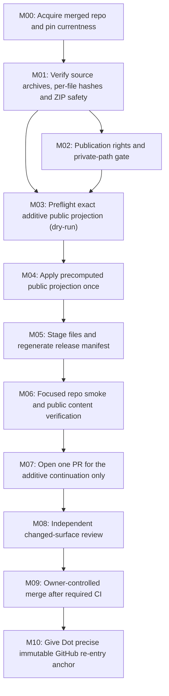

# Private DAG — R0F20

Do not confuse **M01–M10** integration cells with historical numbered T20 research checkpoints.

## Dependency-bound execution (no quota-intensive research re-run)

| Node | Deliverable | Fail-closed stop |
|---|---|---|
| M00 | clean HEAD, baseline ancestor, fixed scientific anchor | live repo or anchored baseline has diverged |
| M01 | 23 archives + 2,821 member checks | any identity mismatch or unsafe ZIP |
| M02 | public/hold disposition; redaction acknowledgement | unresolved confidential/licensing risk |
| M03 | collision-free preimage check | dirty tree, changed owner path or unexpected baseline |
| M04 | new research/t20-live-20261009 tree | existing destination differs |
| M05 | additive staged tree; native release manifest update | unrelated repository paths modified |
| M06 | verified staged exact hashes and narrowly impacted validators | CI/source/status requirements fail |
| M07 | PR URL, HEAD SHA, diff and checks | permission denied, errors or unauthorised scope |
| M08 | review disposition and requirements | missing verification or scientific-scope promotion |
| M09 | actual merged SHA | merge not approved |
| M10 | reference to merged commit and T20 live index | no verified merge SHA |

**Research source lineage**: CP01→CP02→…→CP22 as additive (not cumulative) preservation increments. S01 is an unnumbered later additional mathematical packet. Never represent a later ZIP as containing earlier ZIPs unless its manifest explicitly establishes it.

